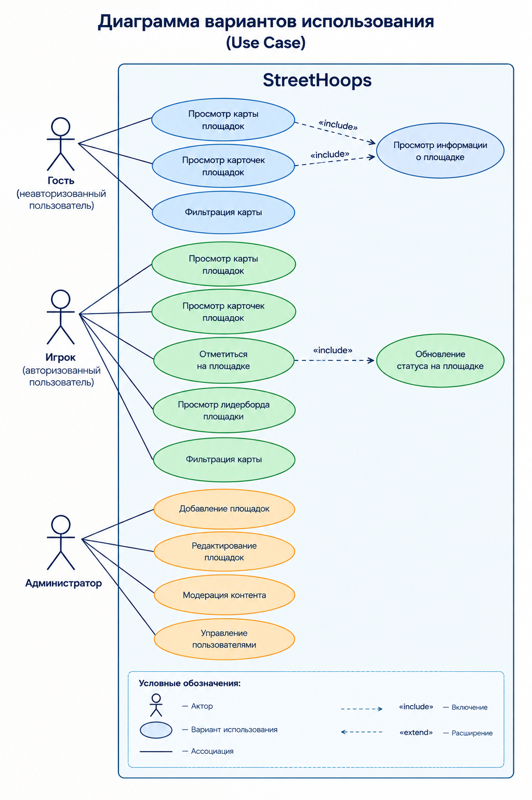
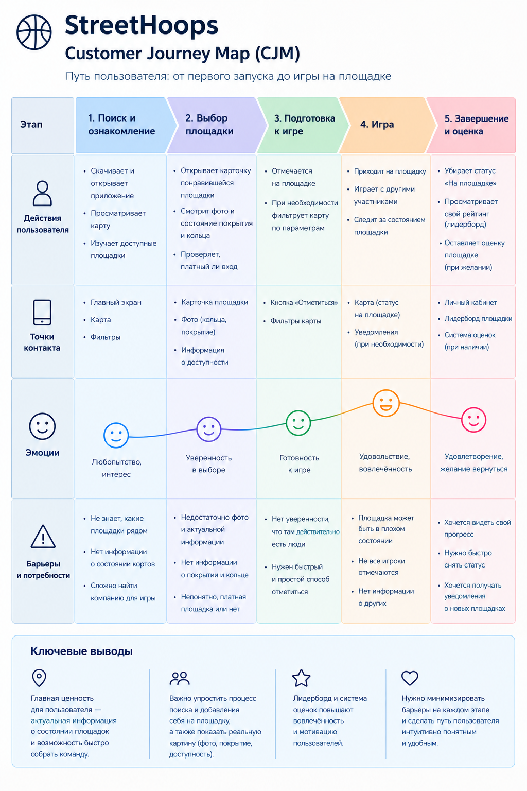

# StreetHoops

Интерактивная карта уличных баскетбольных площадок.
Приложение показывает, где можно поиграть, в каком состоянии площадка и сколько игроков туда собирается. Отдельная вкладка «Тренировки» позволяет игрокам предлагать услуги тренера.

> Домашняя работа №2 по дисциплине «Программирование интернет-приложений»: проектирование и документация API (подход API First).

## Проблема

Любители баскетбола не могут заранее узнать, в каком состоянии ближайшая площадка (покрытие, освещение, платный ли вход) и собирается ли там компания. Общие карты (2ГИС, Яндекс.Карты) показывают только местоположение, а договорённости в пабликах VK и Telegram теряются в ленте.

## Целевая аудитория

- **Основная:** баскетболисты-любители и стритболисты 16–35 лет, играющие на открытых площадках.
- **Вторичная:** организаторы дворовых и любительских турниров.

## Роли

| Роль | Возможности |
|---|---|
| Гость | Просмотр карты, карточек площадок, рейтинга игроков, списка тренеров и их оценок |
| Игрок (`player`) | Всё, что доступно гостю, плюс: отметки «Буду сегодня» / «Не смогу», добавление площадок, создание профиля тренера, оценка тренеров |
| Администратор (`admin`) | Модерация площадок, удаление площадок, управление профилями тренеров и оценками |

## Функциональность

1. **Карта площадок и фильтры (ФТ-01).** Фильтрация по типу покрытия (асфальт, резина, паркет), освещению и статусу «платно / бесплатно», поиск рядом по геолокации.
2. **Отметки на площадке (ФТ-02).** Кнопки «Буду сегодня» и «Не смогу», живой счётчик ожидаемых игроков на карточке.
3. **Рейтинг игроков площадки.** Таблица лидеров по числу посещений.
4. **Тренировки.** Игрок создаёт профиль тренера (специализация, опыт, цена за час, контакты). Другие игроки ставят оценки от 1 до 5 с комментарием, у тренера считается средний рейтинг.
5. **Добавление и модерация площадок.** Новая площадка попадает на проверку администратору.

## Диаграммы

### Диаграмма вариантов использования (Use Case)

Три актора: гость, игрок и администратор. Гость просматривает карту и карточки площадок и фильтрует карту. Игрок дополнительно отмечается на площадке и смотрит лидерборд. Администратор добавляет, редактирует и модерирует площадки и управляет пользователями.



### Customer Journey Map (CJM)

Путь пользователя от первого запуска до игры на площадке: поиск и ознакомление, выбор площадки, подготовка к игре, игра, завершение и оценка. Для каждого этапа показаны действия, точки контакта, эмоции и барьеры.



### ER-диаграмма

| Сущность | Назначение |
|---|---|
| `USER` | Пользователь: имя, email/телефон, хеш пароля, роль |
| `Court` | Площадка: адрес, координаты, покрытие, освещение, платность, фото, статус модерации |
| `Check_IN` | Отметка пользователя на площадке на дату |
| `Court_leaderboard` | Рейтинг игроков площадки по посещениям |
| `Trainer` | Профиль тренера |
| `Trainer_Rating` | Оценка тренера от пользователя |

Подробнее: [docs/er-diagram.xlsx](docs/er-diagram.xlsx)

## API

Контракт описан в [docs/openapi.yaml](docs/openapi.yaml) (OpenAPI 3.0), таблицы endpoints: [docs/endpoints.md](docs/endpoints.md).

| Ресурс | Описание |
|---|---|
| `/auth` | Регистрация и вход (JWT) |
| `/users/me` | Профиль и мои отметки |
| `/courts` | Площадки, фильтры, фото, модерация |
| `/courts/{id}/checkins` | Отметки и счётчик ожидаемых игроков |
| `/courts/{id}/leaderboard` | Рейтинг игроков площадки |
| `/trainers` | Профили тренеров |
| `/trainers/{id}/ratings` | Оценки тренеров |

Аутентификация: HTTP Bearer (JWT). Защищённые методы требуют заголовок `Authorization: Bearer <token>`.

## Нефункциональные требования

- Все запросы по **HTTPS**, включая передачу геолокации и токенов.
- Загрузка карты с пинами до **2 секунд** на 4G при базе от 200 площадок.
- Работа в офлайн-режиме с кэшированной картой и ранее просмотренными карточками.
- Размер кликабельных элементов не менее **44×44 px**.

## Интеграции

- **Geolocation API браузера:** центрирование карты на пользователе. Если доступ не дан, показывается карта с выбором города вручную.

## Дизайн

- [Мобильная версия (Figma)](https://www.figma.com/design/SVPvE64NCbzgItotCnvajc/Street-Hoops?node-id=0-1&p=f&t=1HkbPJb0P6Gz94uV-0)
- [Десктоп-версия (Figma)](https://www.figma.com/design/SVPvE64NCbzgItotCnvajc/Street-Hoops?node-id=197-618&p=f&t=1HkbPJb0P6Gz94uV-0)

## Как посмотреть документацию API

1. Откройте [Swagger Editor](https://editor.swagger.io).
2. File → Import file → выберите `docs/openapi.yaml`.

## Структура репозитория

```
docs/
├── openapi.yaml      # спецификация OpenAPI
├── endpoints.md      # проектирование endpoints
├── er-diagram.xlsx   # ER-диаграмма
├── use-case.png      # диаграмма вариантов использования
└── cjm.png           # Customer Journey Map
README.md
```

## Авторы

- Московский Д.Е., группа АА-25-07

Преподаватель: Казакова А.С.
